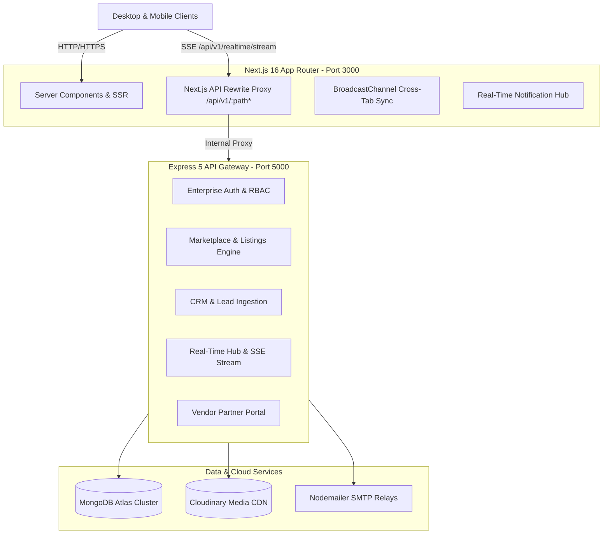

# i-VANTAGE Business Hub & Marketplace

> **Enterprise Multi-Vendor Workspace Marketplace, Commercial Real Estate Platform & Lead Operations System**

---

## 🏛️ Executive Summary

**i-VANTAGE** is an enterprise-grade commercial real estate and business workspace ecosystem designed to power high-velocity property discovery, verified vendor onboarding, instant tour booking, and end-to-end CRM lead dispatching.

The platform is architected around a **Strict Decoupled Client-Server Topology** that enforces zero secret leaks to client bundles while providing ultra-responsive, zero-latency interactions via Server-Sent Events (SSE) and cross-tab synchronizations.

---

## 🏗️ High-Level System Architecture



### Architectural Guarantees
1. **Zero Backend Secret Leaks:** No database URIs, JWT secrets, SMTP credentials, or Cloudinary API secrets are exposed to or bundled with the frontend.
2. **Reverse-Proxy API Tunneling:** Next.js proxies `/api/v1/:path*` directly to the Express backend (`http://localhost:5000/api/v1/:path*`), ensuring single-origin cookies, effortless CORS handling, and seamless mobile testing across Cloudflare Tunnels.
3. **0ms Real-Time Push Engine:** Powered by dual-layer SSE streaming (`/api/v1/realtime/stream`) and sub-second fallback polling with browser `BroadcastChannel` synchronization.

---

## 🚀 Key Modules & Capabilities

### 1. Multi-Vendor Marketplace Engine
* **Hierarchical Taxonomy:** Categorized by City, Micro-market/Location, and Workspace Categories (Coworking, Private Suites, Dedicated Desks, Enterprise Wings).
* **Automated Slug Lifecycle:** Slugs generated on creation and dynamically redirected on renaming to guarantee unbreakable SEO hyperlinks.
* **Security Guardrails:** When a vendor updates critical listing parameters (pricing, location, square footage), status automatically resets to `pending_approval`, preventing unvetted modifications from reaching production.

### 2. Dedicated Vendor Partner Portal (`/vendor/*`)
* **Self-Service Workspace:** Direct vendor authentication, onboarding, listing inventory management, and amenity assignments.
* **Lead Dossiers:** Filtered lead inbox showing enquiries exclusively tied to the vendor's listings.
* **Live Analytics:** Track impressions, tour bookings, and booking conversion velocity.

### 3. SuperAdmin Governance & Team Management
* **6-Tiered Administrative Console:** Real-time visibility across Members, Pending Requests, Pending Invites, Registered Vendors, Audit Logs, and System Metrics.
* **Granular RBAC:** Permissions strictly enforced across SuperAdmin, Admin, Editor, Operations, and Viewer roles.
* **Demotion & Deletion Safeguards:** System permanently prevents the demotion or deletion of the last remaining active SuperAdmin to prevent account lockouts.

### 4. 0ms Real-Time Event & Notification Hub
* **Adaptive Event Streaming:** Server-Sent Events (SSE) keep admin and vendor notification bells updated with zero page reloads.
* **Dynamic Badge Count:** Bell displays unread counts (`1`, `2`, `7`, `9+`) and automatically hides the badge when `unreadCount === 0`.
* **Zero-Latency Cross-Tab Sync:** Actions taken in one browser tab instantly update all other open tabs on the same workstation via `BroadcastChannel`.

### 5. Automated CRM & Double-Dispatch Lead Ingestion
* **Transactional Email Alerts:** Nodemailer dispatches dual notifications:
  * **Branded Client Confirmation:** Immediate inquiry acknowledgement sent to the prospective customer.
  * **Urgent Operations Alert:** Direct notification to sales coordinators with comprehensive lead dossiers.
* **Audit Trail Tracking:** Comprehensive timestamping and status pipelines (`new`, `contacted`, `tour_scheduled`, `negotiating`, `won`, `lost`).

### 6. Cloudinary Media Asset Pipeline
* **Direct Memory Stream Uploads:** Assets are buffered in memory via `multer` and streamed directly via `streamifier` to Cloudinary.
* **Next-Gen Formatting:** Automated delivery in AVIF and WebP with adaptive quality optimization (`q_auto, f_auto`).

---

## 🛠️ Technology Stack Matrix

| Domain | Technology / Library | Version / Details |
| :--- | :--- | :--- |
| **Frontend Framework** | Next.js (App Router) | `16.2.12` with Turbopack |
| **Frontend Runtime** | React / React DOM | `19.2.4` |
| **Styling & Design** | TailwindCSS + Radix UI + Lucide | Curated corporate theme |
| **Backend Framework** | Express.js | `5.2.1` |
| **Database & ODM** | MongoDB Atlas / Mongoose | `9.8.1` |
| **Authentication** | JWT (Dual-Token) + Cookies | `jsonwebtoken` + `cookie-parser` |
| **Real-Time Engine** | Server-Sent Events (SSE) | Native streaming + BroadcastChannel |
| **Media Pipeline** | Cloudinary + Multer + Streamifier | In-memory stream uploads |
| **Transactional Email** | Nodemailer | SMTP double-dispatch |
| **Schema Validation** | Zod | `3.25.x` / `4.4.x` |

---

## 💻 Local Development Setup

### Prerequisites
* **Node.js**: `v20.x` or higher
* **npm**: `v10.x` or higher
* **MongoDB**: Active MongoDB Atlas cluster or local instance

### 1. Repository Setup
```bash
git clone https://github.com/sandeep-asset/i-vantage.git
cd i-vantage
```

### 2. Environment Configuration

#### Backend Configuration (`server/.env`)
Create `server/.env` based on `server/.env.example`:
```env
PORT=5000
NODE_ENV=development
CLIENT_URL=http://localhost:3000
MONGODB_URI=mongodb+srv://<user>:<password>@<cluster>.mongodb.net/<database>?retryWrites=true&w=majority
JWT_ACCESS_SECRET=your_jwt_access_secret_min_32_chars
JWT_REFRESH_SECRET=your_jwt_refresh_secret_min_32_chars
ACCESS_TOKEN_EXPIRES=15m
REFRESH_TOKEN_EXPIRES=7d
CLOUDINARY_CLOUD_NAME=your_cloud_name
CLOUDINARY_API_KEY=your_api_key
CLOUDINARY_API_SECRET=your_api_secret
SMTP_HOST=smtp.gmail.com
SMTP_PORT=587
SMTP_USER=your_email@gmail.com
SMTP_PASS=your_app_specific_password
SMTP_FROM="i-VANTAGE Hub <noreply@i-vantage.in>"
ADMIN_ALERT_EMAIL=leads@i-vantage.in
```

#### Frontend Configuration (`client/.env.local`)
Create `client/.env.local` based on `client/.env.example`:
```env
NEXT_PUBLIC_API_URL=http://localhost:5000/api/v1
NEXT_PUBLIC_CLOUDINARY_CLOUD_NAME=your_cloudinary_cloud_name
NEXT_PUBLIC_DEFAULT_CITY=gurugram
VIKI_API_URL=https://bot.i-vantage.in
MULTIVENDOR_ENABLED=true
```

### 3. Install Dependencies & Run

#### Run Both Concurrently (Root)
```bash
npm run dev
```

#### Or Run Individually
```bash
# Terminal 1 - Backend Server (Port 5000)
cd server
npm run dev

# Terminal 2 - Frontend Client (Port 3000)
cd client
npm run dev
```

* **Frontend:** `http://localhost:3000`
* **Admin Portal:** `http://localhost:3000/admin/login`
* **Vendor Portal:** `http://localhost:3000/vendor/login`
* **Backend API:** `http://localhost:5000/api/v1`

---

## 🔒 Security & Architecture Guardrails

Run the automated architecture guardrail test prior to any production deployment:
```bash
npm run guardrail
```
This check verifies:
1. Zero backend libraries (`mongoose`, `bcryptjs`, `jsonwebtoken`, `nodemailer`) exist in client dependencies.
2. Zero database connection strings or JWT secrets are referenced in client bundles.
3. Strict separation of UI client code and server-side business logic.

---

## 📄 License & Attribution

Copyright &copy; 2026 i-VANTAGE Business Hub. All rights reserved.  
Internal property of i-VANTAGE. Confidential and proprietary.
